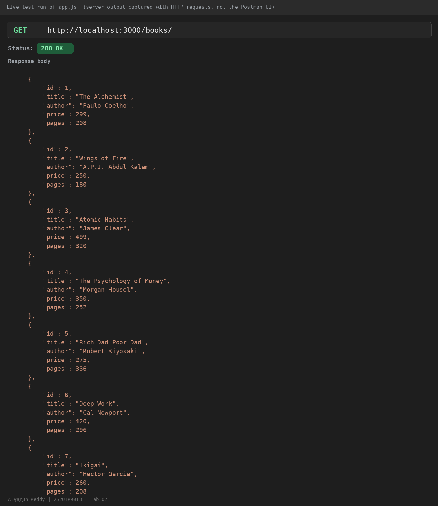
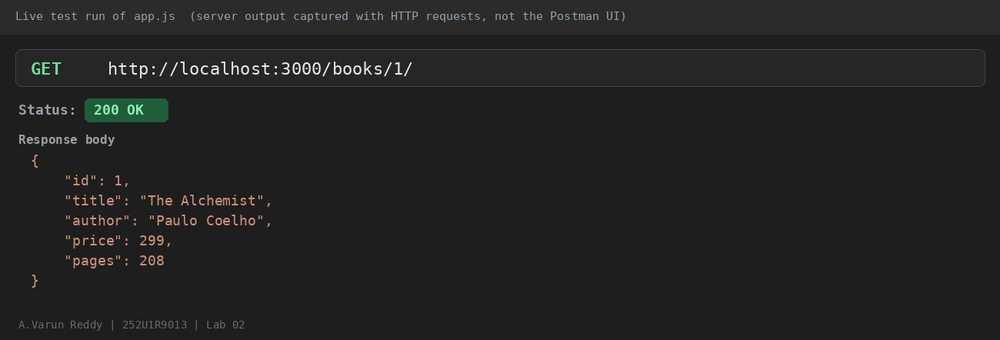
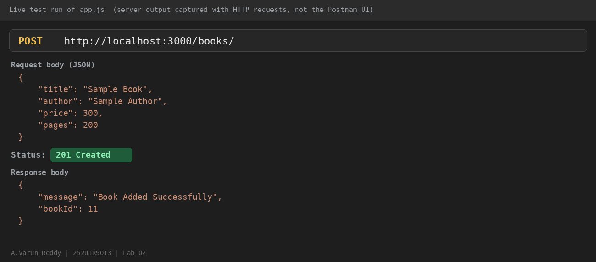
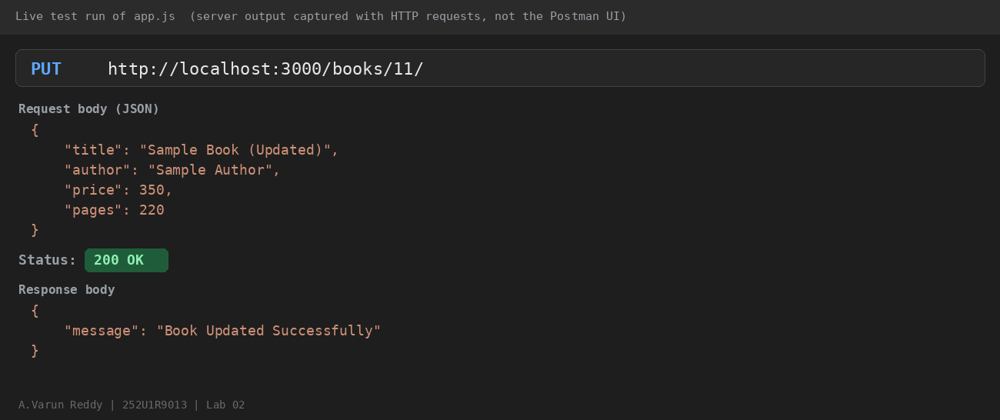
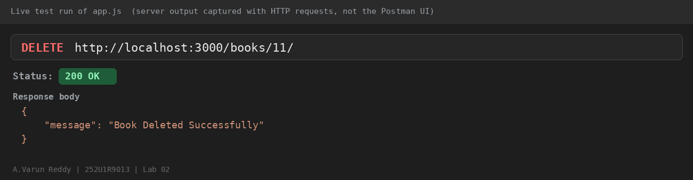
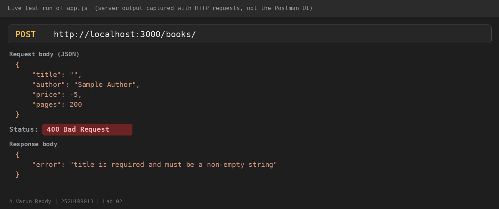
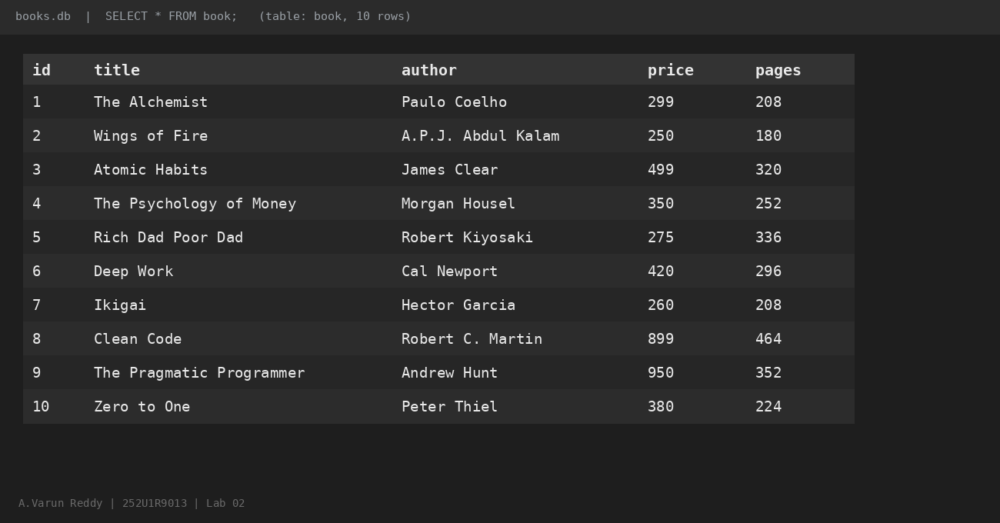

# Lab 2: SQLite database and CRUD routes

- **Name:** A.Varun Reddy
- **Registration Number:** 252U1R9013
- **Section:** CSE-GEN-AI-2A-304
- **Course:** Backend Development Fundamentals
- **Lab Number:** 02

## Live Link

**Deployment URL:** https://lab-reports-2-1.onrender.com/books/

Hosted on Render (free plan). The first request after a period of inactivity can take up to a minute while the service wakes up. Opening the bare URL without `/books/` returns the app's JSON 404 message, which is expected.

## Objective

Connect an Express server to a SQLite database and expose CRUD operations (Create, Read, Update, Delete) over HTTP.

## Technologies Used

Node.js, Express.js, SQLite (`sqlite` + `sqlite3` packages), nodemon, Postman, Visual Studio Code

## Project Structure

```
lab-02/
├── screenshots/
├── app.js            # Express server + SQLite + all routes
├── books.db          # SQLite database file (table: book, 10 rows)
├── seed.sql          # SQL used to create the table and insert the rows
├── package.json
├── package-lock.json
├── .env.example
├── .gitignore
└── README.md
```

## How to Run

**Prerequisites:** Node.js and npm installed. (Optional: the SQLite CLI, to inspect `books.db`.)

```
cd lab-02
npm install
npm run dev      # development: nodemon restarts the server on every change
npm start        # plain start: node app.js
```

The server runs at `http://localhost:3000/`.

**Environment variables:** none are required. `PORT` is optional (default `3000`); see `.env.example`. Never commit a real `.env` file.

### Create the database again (optional)

`books.db` is already included. To rebuild it from scratch with the SQLite CLI:

```
sqlite3 books.db < seed.sql
```

To inspect the data:

```
sqlite3 books.db
.headers on
.mode column
SELECT * FROM book;
```

## Endpoints

| Method | Path             | Description                          | Success status | Error statuses |
| ------ | ---------------- | ------------------------------------ | -------------- | -------------- |
| GET    | `/books/`        | Returns all books                    | 200 OK         | 500            |
| GET    | `/books/:bookId/`| Returns one book by id               | 200 OK         | 400, 404, 500  |
| POST   | `/books/`        | Adds a new book (JSON body)          | 201 Created    | 400, 500       |
| PUT    | `/books/:bookId/`| Updates all fields of a book         | 200 OK         | 400, 404, 500  |
| DELETE | `/books/:bookId/`| Deletes a book                       | 200 OK         | 400, 404, 500  |

**Request body for POST and PUT:**

```json
{
  "title": "Sample Book",
  "author": "Sample Author",
  "price": 300,
  "pages": 200
}
```

- `400 Bad Request`: invalid id, missing or invalid fields, or invalid JSON.
- `404 Not Found`: no book with that id, or an unknown route.
- Every query that uses user input is parameterised with `?` placeholders.

## Screenshots

Screenshots of each endpoint (request, status and response from a live run of the server), plus the database view:

### GET all books



### GET one book



### POST add a book (201)



### PUT update a book



### DELETE remove a book



### Invalid input (400)



### SQLite database (books table, 10 rows)



## Viva Questions

### 1. Why `await` the database call?

Every database query is asynchronous and returns a Promise. Without `await`, the next line would run before the rows arrive and I would be working with a pending Promise instead of the data. `await` makes the function wait for the result, and the same idea is used in `initializeDBAndServer()` so the server only starts listening once the database connection has opened successfully.

### 2. What is SQL injection and how do placeholders prevent it?

SQL injection happens when user input is joined into the SQL string, so an input like `1 OR 1=1` changes what the query does. With `?` placeholders the query text is fixed first and the values are passed separately, so the database always treats the input as plain data and never as SQL.

### 3. When is PUT used instead of POST?

POST is used to create a new record, and the server decides its id. PUT is used when the record already exists at a known URL, such as `/books/3/`, and its fields need to be updated.

## Notes: Problems Faced and Solutions

- **Render deploy crashed on start (`GLIBC_2.38 not found`).** The deploy logs showed `ERR_DLOPEN_FAILED` for `node_sqlite3.node`. The `sqlite3` v6 package ships a prebuilt binary that needs a newer Linux C library than Render's servers have. I fixed it by changing the dependency to `sqlite3@5.1.7` in `package.json`, committing, and redeploying.
- Opening the Render URL without `/books/` shows the JSON 404 message because the app has no route at `/`. The working endpoints all start with `/books/`.
- The free hosting plan used for deployment may reset the file system on restart, so changes made through POST, PUT and DELETE on the live link can disappear after a redeploy. The local `books.db` file keeps changes.
